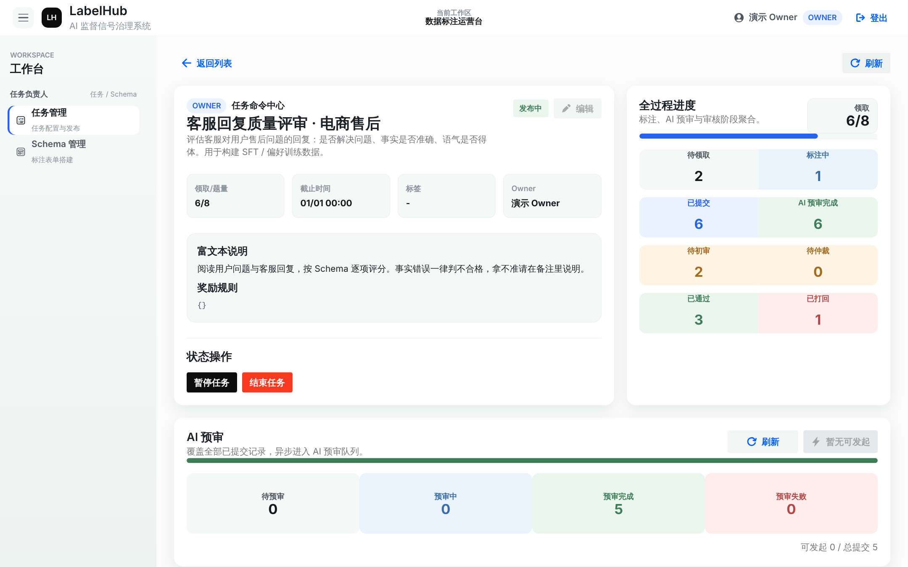
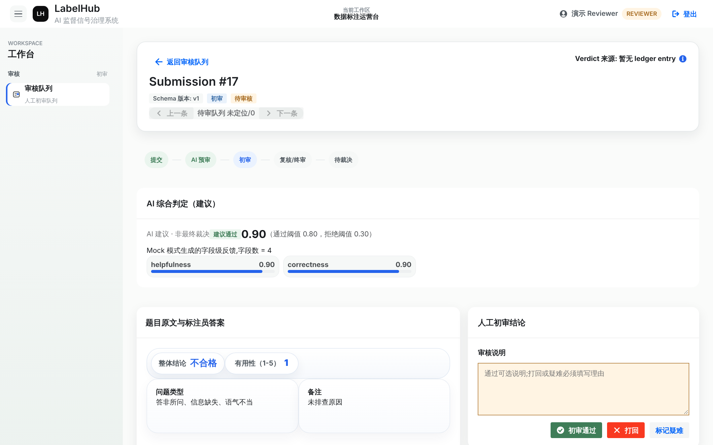
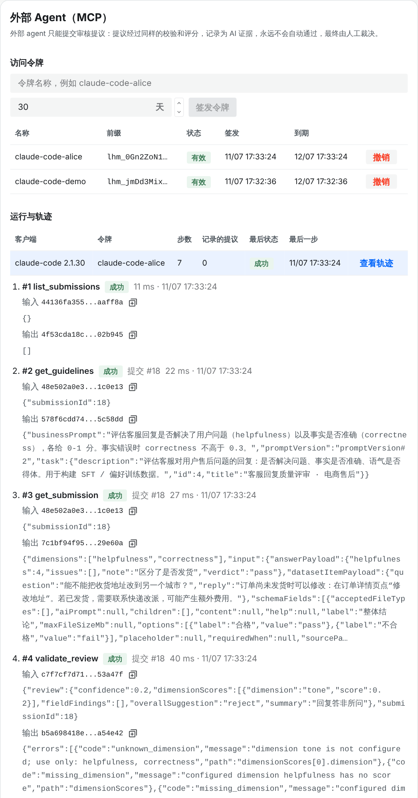

<div align="center">

# LabelHub

**A trustworthy workbench for producing LLM training data: AI provides evidence, humans make the final call, and every delivery is reproducible and verifiable.**

[](https://github.com/Iceberg86-gb/labelhub-platform/actions/workflows/ci.yml)
[](LICENSE)


[中文](README.md) · [Quick start](#quick-start) · [Eval results](#evidence-not-claims) · [Docs](docs/README.md)

</div>

---

Most labeling tools answer "is the data labeled yet?". LabelHub also answers:

> **Why should anyone believe this training data is correct?**

Every key fact — schema versions, submissions, AI calls, human verdicts, export snapshots — is recorded **append-only**. AI output enters the ledger as evidence; a human makes the final decision. Exporting the same data twice yields byte-identical files. Every change to AI behaviour must first prove itself on a fixed golden set with reproducible offline evals before it can be merged.



## Highlights

- **AI is evidence, not a verdict.** AI pre-review results are stored with prompt version, model, input hash, cost and latency, shown to reviewers, and never overwrite the human decision ([ADR-005](docs/adr/ADR-005-ai-evidence-not-verdict.md)).
- **A self-correcting review agent.** A deterministic validator checks model output (field references, dimensions, thresholds); the agent fixes form over a multi-turn loop but may not change its judgement ([ADR-019](docs/adr/ADR-019-h2-review-output-validation-loop.md)).
- **Gated automation.** Escalation rules and thresholds come from offline calibration. Auto-accept is off by default and requires shadow evidence (Wilson 95% upper bound), blind sampling and a circuit breaker ([ADR-020](docs/adr/ADR-020-h3-policy-layer.md)).
- **External agents under the same rules.** A built-in MCP server lets Claude Code and other agents join with owner-issued, task-scoped tokens. They submit *proposals* that go through the same validation and scoring, are never auto-accepted, and every tool call lands in an append-only trajectory ([ADR-022](docs/adr/ADR-022-h5-mcp-server.md)).
- **Reproducible offline evals.** HelpSteer2 golden set (1,038 items), byte-for-byte record/replay of model calls, replayed by CI; sign in with a ChatGPT account to run real-model evals ([ADR-017](docs/adr/ADR-017-annotation-agent-harness.md) / [018](docs/adr/ADR-018-chatgpt-sign-in-for-local-evals.md)).
- **Contract-first, immutable facts.** OpenAPI is the single API source; frontend types are generated. Append-only mappers expose insert/select only (contract-tested). Integration tests run on real MySQL via Testcontainers, and CI fails if any is skipped.

## Evidence, not claims

Golden set: all 1,038 HelpSteer2 validation rows; model `gpt-6.1-terra@low`. Every number replays byte-for-byte from committed recordings.

| Stage | Change | Result | Outcome |
|---|---|---|---|
| H1 | Single-call baseline | Auto-pass error 8.93%, κ 0.34, 33% to manual review | Baseline |
| H2 | Validate → correct loop | All 562 invalid field references fixed, 333 judgement conflicts flagged, auto-pass error unchanged | ✅ merged |
| H3 | Escalation rules + calibration | At ≤ 25% arbitration budget, held-out bad exports per 1,000 drop from **21.1 to 8.5** (e = 0.10) | ✅ merged |
| H4 | BM25 precedent memory | Held-out bad exports 8.48 → **10.00** (worse) | ❌ **rejected by the gate** ([ADR-021](docs/adr/ADR-021-h4-precedent-memory.md)) |
| H5 | MCP server | The official MCP Java SDK client completes an audited demo review | ✅ merged |

H4 is a negative result, kept on record: κ rose from 0.34 to 0.39, yet calibrated risk got worse. The precedent pool is mostly "approved", so lexical similarity mainly imported the base rate rather than item-specific signal. **That is exactly what the gate exists to catch.**

## Screenshots

| Reviewer workbench: AI evidence + human verdict | MCP trajectory of an external agent (real session) |
|---|---|
|  |  |

## Quick start

Requirements: JDK 17, Node 20+, pnpm 9, Docker, Python 3.11+ (evals only).

```bash
make dev-up                          # MySQL 8 + MinIO
make dev-api                         # API on :8080/api (local profile seeds demo accounts)
pnpm install && pnpm --filter @labelhub/web dev    # web on http://127.0.0.1:5173
python3 scripts/seed-demo.py         # optional: walk one full demo pipeline through the API
```

Demo accounts (password `demo1234`): `owner_demo`, `labeler_demo`, `reviewer_demo`, `senior_reviewer_demo`.

Connect an external agent after issuing a token in the task's "External Agent (MCP)" panel:

```bash
claude mcp add --transport http labelhub http://localhost:8081/mcp --header "Authorization: Bearer <token>"
```

Offline evals: `make evals` (offline, no credentials) and `make evals-baseline` (replays all H1–H3 real-model results).

## Verification

```bash
make verify                                          # backend unit + Testcontainers integration tests
pnpm --filter @labelhub/web lint && pnpm --filter @labelhub/web typecheck && pnpm --filter @labelhub/web test
make evals
```

## Documentation

Start at [docs/README.md](docs/README.md) (Chinese). Architecture decisions: [docs/adr/](docs/adr/). Entry point for AI coding agents: [AGENTS.md](AGENTS.md).

## Contributing & license

See [CONTRIBUTING.md](CONTRIBUTING.md) and [SECURITY.md](SECURITY.md). Licensed under [Apache 2.0](LICENSE). The HelpSteer2 eval data is by NVIDIA under CC-BY-4.0 ([notice](evals/datasets/helpsteer2-h1/NOTICE.md)).
