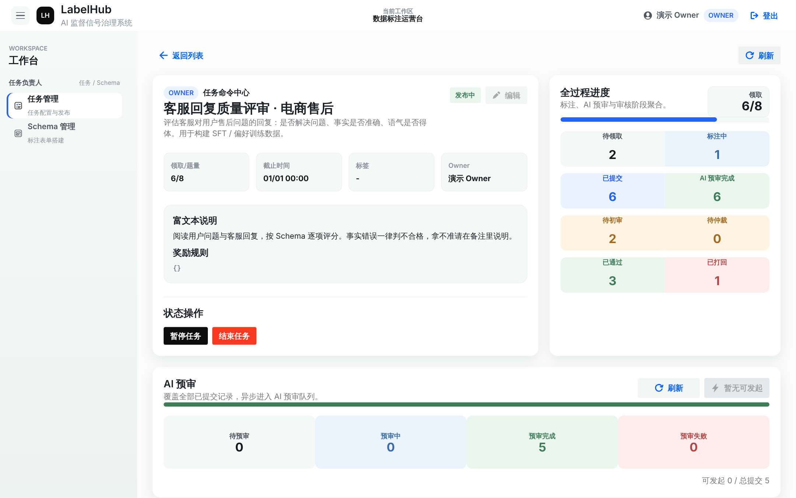
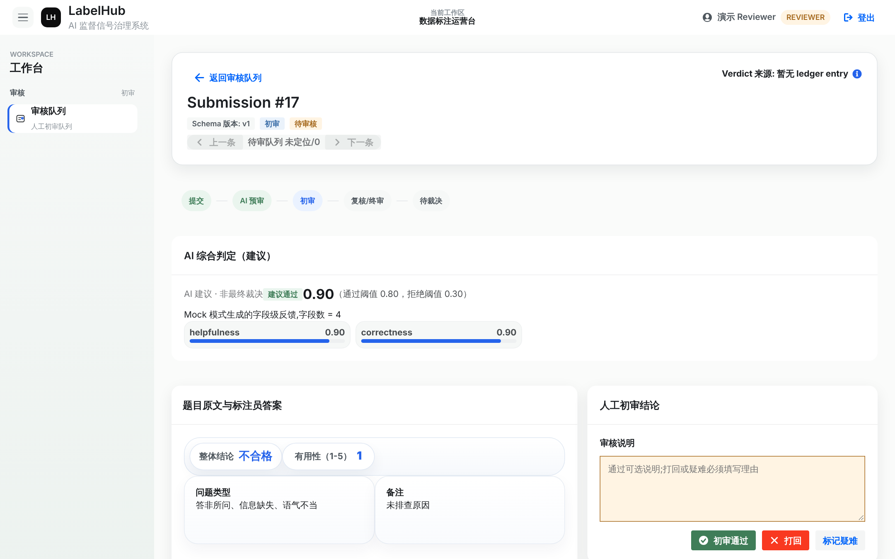
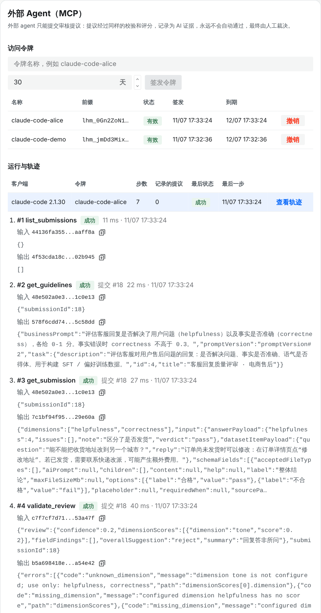
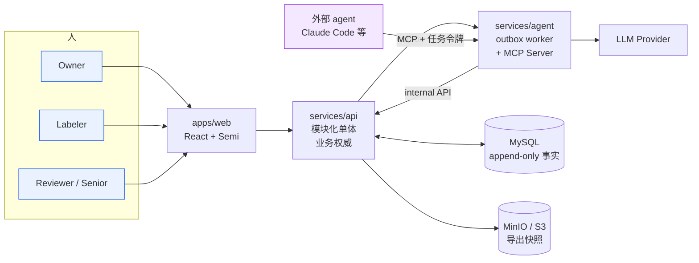

<div align="center">

# LabelHub

**面向 LLM 训练数据生产的可信工作台：AI 提供证据，人类做最终裁决，每一份交付都可以复现和验证。**

[](https://github.com/Iceberg86-gb/labelhub-platform/actions/workflows/ci.yml)
[](LICENSE)


[English](README.en.md) · [快速开始](#快速开始) · [评测结果](#用评测说话) · [架构](#架构) · [文档](docs/README.md)

</div>

---

大多数标注工具只回答"数据标完了没有"。LabelHub 还要回答另一个问题：

> **你凭什么说这批训练数据是对的？**

为此，每一个关键事实都以 **append-only** 的方式记录下来，包括 Schema 版本、提交、AI 调用、人工裁决和导出快照。AI 的结论只作为证据进入账本，最终裁决由人做出。同一份数据导出两次，得到的文件逐字节相同。AI 能力的每一次改动，都要先用固定黄金集上的离线评测证明有提升，才允许合并。



## 亮点

- **AI 是证据，不是裁决。** AI 预审结果连同 prompt 版本、模型、input hash、成本和延迟一起写入账本，供审核员参考，但不能改写最终结论（[ADR-005](docs/adr/ADR-005-ai-evidence-not-verdict.md)）。
- **自我纠错的审核 agent。** 模型输出先经过确定性校验器（字段引用、维度、阈值）检查，再在多轮对话中自我修正。修正只能改格式，不能改判断（[ADR-019](docs/adr/ADR-019-h2-review-output-validation-loop.md)）。
- **有门槛的自动化。** 升级规则和阈值由离线校准选出。自动通过默认关闭，开启需要同时满足：影子数据的 Wilson 95% 上界达标、盲审抽检、显著超标时自动熔断（[ADR-020](docs/adr/ADR-020-h3-policy-layer.md)）。
- **外部 agent 也受同样的约束。** 内置 MCP Server，Claude Code 等 agent 用 Owner 按任务签发的令牌接入。外部 agent 只能提交"提议"，提议走同一套校验和评分，永远不会自动通过，每一次工具调用都写入只追加的轨迹（[ADR-022](docs/adr/ADR-022-h5-mcp-server.md)）。
- **可复现的离线评测。** 评测基于 HelpSteer2 黄金集（1038 条），模型调用的录制和回放逐字节复现，CI 每次都会回放验证。用 ChatGPT 账号登录就能跑真实模型评测（[ADR-017](docs/adr/ADR-017-annotation-agent-harness.md) / [018](docs/adr/ADR-018-chatgpt-sign-in-for-local-evals.md)）。
- **契约先行，事实不可变。** OpenAPI 是唯一的接口源头，前端类型全部由它生成。append-only 表对应的 Mapper 只允许 insert 和 select，由契约测试守护。集成测试一律跑真实的 MySQL（Testcontainers），有测试被跳过时 CI 直接判失败。

## 用评测说话

固定黄金集为 HelpSteer2 validation 全量 1038 条，模型为 `gpt-6.1-terra@low`。下面每个数字都可以从仓库里提交的录制逐字节回放出来。

| 阶段 | 改动 | 结果 | 结论 |
|---|---|---|---|
| H1 | 单次调用基线 | 自动通过区错误率 8.93%，κ 0.34，转人工 33% | 基线，[报告](evals/reports/w1-baseline.md) |
| H2 | 校验 → 纠错循环 | 562 条无效字段引用全部修正，333 条判断不一致被标记，自动通过区错误率持平 | ✅ 合并，[报告](evals/reports/w2v2-vs-w1.md) |
| H3 | 升级规则 + 阈值校准 | 仲裁预算 ≤ 25% 时，留出集每千条坏样本导出从 **21.1 降到 8.5**（e = 0.10） | ✅ 合并，[报告](evals/reports/w3a-calibration.md) |
| H4 | BM25 判例记忆 | 留出集坏样本 8.48 → **10.00**，反而变差 | ❌ **按关卡拒绝合并**，[ADR-021](docs/adr/ADR-021-h4-precedent-memory.md) |
| H5 | MCP Server | 官方 MCP Java SDK 客户端完成一次受审计的演示审核 | ✅ 合并 |

H4 是一个负结果，我们把它完整留了档。BM25 判例让 κ 从 0.34 升到 0.39，表面上看更准了，但校准后的风险指标反而变差：判例池以"通过"为主，词法相似度带来的主要是这个基础比例，而不是与当前条目相关的质量信号。**关卡的意义，就在于拦下这种"看起来有提升"的改动。**

## 截图

| 审核员工作台：AI 证据 + 人工裁决 | 外部 agent 的 MCP 轨迹（真实会话） |
|---|---|
|  |  |

右图是 Claude Code 风格的客户端经 MCP 完成的一次会话。第一次提交的提议因为维度不对被校验器拒绝，修正后的提议被如实记为"已有 AI 审核（重放）"，最后一步交还人工。每一步都存了输入和输出的 hash，摘要经过脱敏。

## 架构



- **请求边界**：所有业务写入只经过 `services/api`。业务状态和 outbox 事件在同一个事务里写入（[ADR-008](docs/adr/ADR-008-outbox-pattern.md)）。
- **异步边界**：`services/agent` 消费 outbox，执行 AI 预审（含校验和纠错循环）和导出，具备幂等、重试和死信。外部 agent 也经它接入，每次调用都由 API 授权并记录轨迹。
- **契约边界**：`packages/contracts/openapi/labelhub.yaml` 是唯一的 API 源头（[ADR-012](docs/adr/ADR-012-contract-first-openapi.md)）。

<details>
<summary><b>核心设计取舍</b></summary>

| 取舍 | 理由 | 记录 |
|---|---|---|
| AI 是证据，不是裁决 | 人类审核者是训练数据准入的问责闸门。唯一的例外是 Owner 显式开启的自动通过，此时由 Owner 问责，且受影子门槛、盲审抽检和熔断约束；策略准入的数据默认不导出。 | [ADR-005](docs/adr/ADR-005-ai-evidence-not-verdict.md) / [020](docs/adr/ADR-020-h3-policy-layer.md) |
| 事实只追加，不修改 | 已发布的 Schema 版本不可变；裁决从最新的账本条目实时派生，用读时计算换写路径的简单和事实的不可篡改。 | [ADR-002](docs/adr/ADR-002-schema-immutability.md) / [003](docs/adr/ADR-003-quality-ledger.md) / [009](docs/adr/ADR-009-local-immutability.md) |
| 导出可复现 | 规范化序列化后，同一份数据导出两次，文件和 manifest 哈希逐字节相同。 | [ADR-004](docs/adr/ADR-004-export-snapshot.md) |
| 结构化输出是硬约束 | AI 预审必须通过 function calling 输出；校验失败走确定性的纠错或转人工。 | [ADR-006](docs/adr/ADR-006-function-calling-required.md) / [019](docs/adr/ADR-019-h2-review-output-validation-loop.md) |
| 拒绝静默回退 | Provider 配置出错时，失败在重试和死信链路上显式暴露。 | [ADR-011](docs/adr/ADR-011-doubao-default-openai-fallback.md) |
| 模块化单体 + 独立 worker | 业务模块靠包边界隔离，单库单进程；只有异步、可能独立失败的 AI worker 拆成单独进程。 | [ADR-001](docs/adr/ADR-001-modular-monolith.md) |
| 先评测，再合并 | AI 能力的改动必须在固定黄金集上证明有提升，否则不合并，负结果同样留档。 | [ADR-017](docs/adr/ADR-017-annotation-agent-harness.md) |

</details>

## 快速开始

依赖：JDK 17、Node 20+、pnpm 9、Docker、Python 3.11+（只有评测需要）。

```bash
make dev-up                          # MySQL 8 + MinIO
make dev-api                         # 后端 :8080/api（本地 profile 会写入演示账号）
pnpm install && pnpm --filter @labelhub/web dev    # 前端 http://127.0.0.1:5173
python3 scripts/seed-demo.py         # 可选：通过 API 走完一条完整演示链路
```

演示账号的密码都是 `demo1234`：`owner_demo`、`labeler_demo`、`reviewer_demo`、`senior_reviewer_demo`。详细说明见[开发环境指南](docs/guides/dev-environment.md)。

**接入外部 agent（MCP）**：Owner 在任务页「外部 Agent（MCP）」面板签发令牌，然后：

```bash
claude mcp add --transport http labelhub http://localhost:8081/mcp --header "Authorization: Bearer <令牌>"
```

工具列表和治理规则见[外部 agent 接入指南](docs/guides/external-agent-mcp.md)。

**离线评测**：

```bash
make evals                           # 单元测试 + 冒烟基线回放，不联网、不需要凭据
make evals-baseline                  # 下载固定版本的 HelpSteer2，回放 H1–H3 的全部真实模型结果
```

## 验证

CI 每次 push 都会执行同样的检查，有任何集成测试被跳过时直接判失败：

```bash
make verify                                          # 后端单元测试 + Testcontainers 集成测试
pnpm --filter @labelhub/web lint && pnpm --filter @labelhub/web typecheck && pnpm --filter @labelhub/web test
make evals
```

## 角色

| 角色 | 职责 |
|---|---|
| Owner | 创建任务、导入数据集、设计并发布 Schema、配置 AI 审核规则、签发 MCP 令牌、创建可信导出 |
| Labeler | 先到先得领取（乐观锁守护配额，[ADR-007](docs/adr/ADR-007-fcfs-distribution.md)），按领取时绑定的 Schema 版本作答 |
| Reviewer | 参考 AI 证据做初审；抽检样本以盲审方式呈现 |
| Senior Reviewer | 处理 AI 升级、人机分歧和疑难标记的仲裁 |
| Platform Admin | 配置 LLM Provider（密钥加密存库）、查看成本和效率仪表盘、管理用户、查看审计日志 |

## 仓库结构

```
apps/web/              React 18 + TypeScript + Vite，Semi Design，Feature-Sliced Design（ADR-013）
services/api/          Spring Boot 模块化单体：业务权威、契约实现、Flyway 迁移
services/agent/        outbox worker（AI 预审 + 纠错循环、导出）与 MCP Server
packages/contracts/    OpenAPI 契约（唯一源头）与 Java / Python 共享的校验语料
evals/                 离线评测（Python）：黄金集、录制/回放、校准、ChatGPT 登录
infra/                 本地 / 演示 / 生产 compose，nginx，MinIO 初始化
scripts/               开发启动、演示数据、部署与 CI 辅助脚本
docs/                  设计基线、ADR、指南、设计系统、过程记录
```

## 路线图

第一轮"标注 Agent Harness"（[ADR-017](docs/adr/ADR-017-annotation-agent-harness.md)）已经全部走完：每个阶段（W 是交付批次，H 是对应的评测关卡）都过了关卡，或者被关卡拦下。各阶段的数据见上面的[评测表](#用评测说话)。

| 阶段 | 内容 | 结果 |
|---|---|---|
| W0 | CI 基线：集成测试真实运行，跳过即失败 | ✅ |
| W1 / H1 | 离线评测框架与单次调用基线 | ✅ |
| W2 / H2 | 校验 → 纠错循环 | ✅ |
| W3 / H3 | 升级规则、阈值校准、受控的自动通过 | ✅ |
| W4 / H4 | BM25 判例记忆 | ❌ 被关卡拒绝，未合并（[ADR-021](docs/adr/ADR-021-h4-precedent-memory.md)） |
| W5 / H5 | MCP Server：外部 agent 受同样的治理与审计约束 | ✅ |

**接下来**（都还没开始）：

- [ ] **判例记忆第二版**：按裁决分层取判例，避免判例池的基础比例主导结果。必须重新跑一轮真实评测并通过 H4 关卡才能合并。
- [ ] **`/mcp` 的生产暴露**：需要运维决定是否开放、用哪个域名（[humanpending #275](docs/process/humanpending.md)）。
- [ ] **导出快照 diff**：审计动作已经预留（`export.snapshot_diff`），还没有实现。

## 文档

从 [**docs/README.md**](docs/README.md) 开始。常用入口：[设计基线](docs/architecture/labelhub-complete-design-baseline.md) · [架构决策记录](docs/adr/)（ADR-001 ~ 022）· [工程规范](docs/engineering/conventions.md) · [AI 编码 agent 入口 AGENTS.md](AGENTS.md) · [批次审计台账](docs/process/humanpending.md)。

## 在线演示

演示入口是 `http://120.26.182.61:8443/`（备案和 HTTPS 尚未完成，访问时必须带 `http://` 和 `:8443`），账号由项目 Owner 私下发放。部署方式见[演示环境说明](docs/guides/demo-environment.md)。

## 参与贡献

欢迎提 issue 和 PR，请先读 [CONTRIBUTING.md](CONTRIBUTING.md)。安全问题请按 [SECURITY.md](SECURITY.md) 私下报告。

## 许可证

[Apache License 2.0](LICENSE)。评测数据集 HelpSteer2 由 NVIDIA 以 CC-BY-4.0 发布，署名见 [`evals/datasets/helpsteer2-h1/NOTICE.md`](evals/datasets/helpsteer2-h1/NOTICE.md)。
